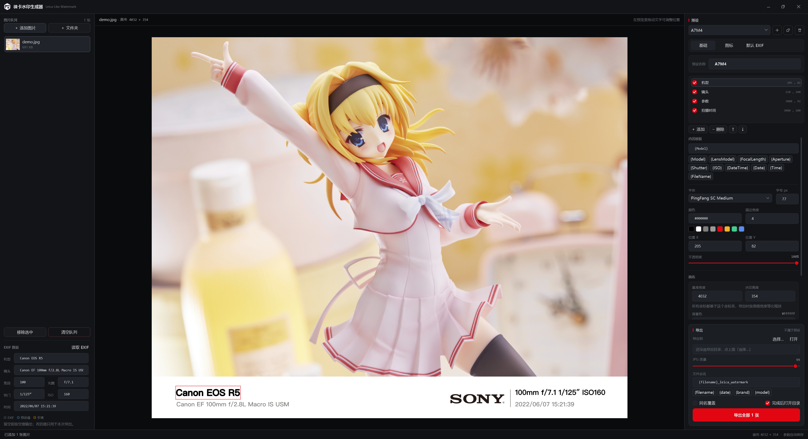

# 徕卡水印生成器-Windows
<p align="center">
  
</p>

<div align="center">
  
  
  
</div>

## 简介

Windows 下的 Leica Like Watermark 生成器。给相机照片底部加一条徕卡风格的水印（机型 / 镜头 / 参数 / 时间 / 品牌 Logo）。

带图形界面：拖几张图进队列 → 选一个预设 → 导出到你指定的目录。水印的字号、颜色、位置、描边、Logo、背景色全部可以在界面里调，中间实时预览，也可以直接在预览里拖动文字定位。



## 使用流程

01. **添加图片**：点「添加图片」「添加文件夹」，或直接把文件/文件夹拖进窗口。队列里只保存文件引用，不会复制或移动原图。
02. **套用预设**：右侧栏顶部的下拉框选择预设。预设 = 一套水印样式（文字 / 图标 / 画布）+ 一份默认 EXIF。
03. **微调**：右侧三个页签
    - **基础**：预设名、文字行（可增删排序）、内容模板（`{Model}`、`{FocalLength}mm {Aperture} {Shutter} ISO{ISO}` 这类占位符）、字体、字号、颜色、描边、X/Y、不透明度；往下是画布基准尺寸、水印高度、背景色、等效焦距系数。
    - **图标**：品牌 Logo（PNG，带 alpha）、宽度、位置、不透明度；分隔竖线的开关与颜色。
    - **默认 EXIF**：这个预设自带的一套拍摄参数，专门给「没有 EXIF 的图片」用。可以「用当前图片填充」把某张图的参数存成模板，也可以清空。
04. **导出**：右下角那一块就是全部导出设置——导出目录、JPG 质量、文件命名、是否覆盖、完成后是否打开目录，最后是导出按钮。这些都属于程序设置，换预设不会跟着变。

### EXIF 面板

左边是当前图片的拍摄参数，自动从文件里读。**读不到就留空**，不做任何猜测，也不会拿预设里的假数据顶上去——空着的行在导出时直接不渲染，不会出现 `mm ISO` 这种残句。

| 底色 | 含义 |
|---|---|
| 默认 | 来自文件里的 EXIF |
| 蓝色 | 套用了预设里的「默认 EXIF」 |
| 橙色 | 手动改过，和原值不一样 |

标题右边那个按钮会变：图片**有** EXIF 时是「读取 EXIF」，重新读文件；图片**没有** EXIF 时是「读取预设 EXIF」，把「默认 EXIF」页里那套值一键填进来。

改完的值只用于这次导出，不写回原图。手填或套用之后水印会立刻跟着变；改「默认 EXIF」页里的值时，已经套用过这套值的图片会同步更新。

### 快捷键

| 快捷键 | 作用 |
|---|---|
| `Ctrl + O` | 添加图片 |
| `Ctrl + E` | 导出全部 |
| `Delete` | 从队列移除选中图片 |

## 配置与数据

所有设置保存在程序目录的 `presets.json`（预设 + 输出设置），改完自动保存，不用手改 JSON。

首次运行如果检测到旧版本的 `config.json`，会把里面的预设、JPG 质量、等效焦距系数迁移过来，并按厂牌自动匹配 `img/*.png` 里的 Logo；旧配置里「无 EXIF 时用的那套假参数」会迁移成预设的「默认 EXIF」（只做模板，不会自动套到图片上）。

> 旧版的 `UserData/Input/{机型}` 目录约定已经不需要了：机型不再靠文件夹分类，改成队列 + 预设。

## 图标与字体

- `icon.ico`：程序图标（带 alpha），同时用于窗口图标和 exe 图标。
- `img/*.png`：品牌 Logo，可以自己加 PNG，文件名就是厂牌名。
- 内置字体 `PingFang SC Medium` 以资源形式嵌入，换机器不会掉版式。

## 构建

需要 .NET 10 SDK（Windows）：

```bash
dotnet build leica-watermark-generator/leica-watermark-generator.csproj
dotnet run --project leica-watermark-generator
```

发布单文件：

```bash
dotnet publish leica-watermark-generator/leica-watermark-generator.csproj -c Release -r win-x64 --self-contained false -p:PublishSingleFile=true
```

## 配置文件（旧版，仅用于迁移）

<details>
<summary>点开看旧版 config.json 字段</summary>

| 参数名 | 说明 |
| --------- | ------- |
| IgnoreLensModel | 从 EXIF 中读出这些镜头时忽略（如老蛙镜头会写入 `----`） |
| NoExifImageConfig | 无法读取 EXIF 时的处理方式 |
| --UsePresetInsteadRealtimeUserSelection | 是否使用预设值 |
| --PresetSettings | 预设值（名称/厂商/机型/镜头/焦段/ISO/快门/光圈/时间） |
| --ModelOptions / LensModelOptions / ... | 手动选择时的候选选项 |
| EquivalentFocalLength | 等效焦距系数 |
| SaveJPG_Quality | 输出 JPG 质量 |

</details>
